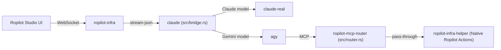

# RopilotGemini

[](https://github.com/xDTaraZz/RopilotGemini/actions/workflows/ci.yml)
[](https://github.com/xDTaraZz/RopilotGemini)
[](LICENSE)
[](https://github.com/xDTaraZz)

A local bridge that lets you run Google Antigravity CLI (`agy`) Gemini models inside **Ropilot Studio** while keeping Ropilot's original Roblox Studio tooling and actions intact.

## Why This Exists

Ropilot Studio includes Source Control script diffs, Studio viewport screenshots, Playtest panels, Blender integration, and session checkpoints. All of those depend on Ropilot's own MCP server (`ropilot-infra-helper`) and `stream-json` protocol.

RopilotGemini sits in Ropilot's local Claude CLI slot (`claude` / `claude.exe`) and translates messages to `agy` without replacing Ropilot's backend:

- **Dynamic model catalog:** `main.min.js` queries `agy models` over IPC (`get-agy-models`) and updates the Gemini tab and reasoning levels automatically. Missing models fail with an explicit error instead of silently swapping to a different model.
- **Native Ropilot behavior:** `src/router.rs` forwards MCP traffic straight through to `ropilot-infra-helper`. You keep `Thought for Ns` and `Worked for Ns` folding, inline script diffs, Studio screenshots, and Ropilot Actions.
- **Claude preserved:** Selecting any Claude model forwards arguments directly to your backed-up `claude-real` binary.
- **Transactional install & clean uninstall:** Binaries are staged and `app.asar` is patched before anything is overwritten. Uninstalling restores `app.asar.bak`, restores `claude-real`, restores Antigravity's original `mcp_config.json` entry from `mcp-backup.json`, and removes bridge state files.
- **Safe permission mode by default:** Uses `--mode accept-edits` by default unless Ropilot itself passes `--dangerously-skip-permissions` or you opt in via `ROPILOT_GEMINI_SKIP_PERMISSIONS=1`.

## Architecture



## Requirements

- **Ropilot Studio** installed (Windows, macOS, or Linux)
- **Antigravity CLI** (`agy` / `agy.exe`) installed and signed in
- **Rust** (`rustc` 2021 edition)
- **Node.js** (v18+) and **npm** (used to install pinned `@electron/asar@3.2.15`)

## Install

### Windows (PowerShell)

```powershell
git clone https://github.com/xDTaraZz/RopilotGemini.git
cd RopilotGemini
powershell -ExecutionPolicy Bypass -File .\install.ps1
```

### macOS / Linux

```bash
git clone https://github.com/xDTaraZz/RopilotGemini.git
cd RopilotGemini
chmod +x install.sh uninstall.sh
./install.sh
```

## Updating After a Ropilot Studio Update

Ropilot Studio updates overwrite `resources/app.asar` and may reset `claude`. Because `patcher/patch_asar.mjs` reads your newly updated `app.asar` and applies targeted anchor patches (refreshing `app.asar.bak` whenever it sees a stock bundle), re-run `install.ps1` (Windows) or `./install.sh` (macOS/Linux). If an upstream update changes an anchor, the patcher stops before touching `app.asar` and reports the missing anchor.

## Uninstall

### Windows

```powershell
powershell -ExecutionPolicy Bypass -File .\uninstall.ps1
```

### macOS / Linux

```bash
./uninstall.sh
```

## Credits & Good-Faith Notice

- **Ropilot Studio** by the Ropilot team ([ropilot.ai](https://ropilot.ai)) — all Roblox Studio tooling, Source Control, Blender pipelines, Playtest integration, and Ropilot Actions belong to Ropilot Studio.
- **RopilotGemini** by **[xDTaraZ](https://github.com/xDTaraZz)**.

This is an unofficial community bridge built out of appreciation for Ropilot Studio so users can run their local `agy` CLI alongside Ropilot's native tools. It is not intended to harm, bypass, or disparage Ropilot Studio in any way.

## License

[MIT](LICENSE) © xDTaraZ