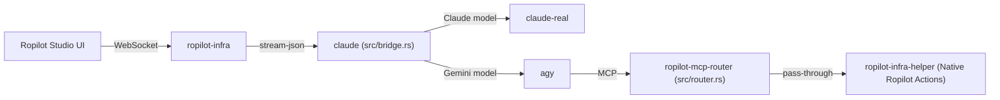

# RopilotGemini

[](https://github.com/xDTaraZz/RopilotGemini)
[](https://www.rust-lang.org/)
[](https://nodejs.org/)
[](https://github.com/xDTaraZz)

A local bridge that lets you run Google Antigravity CLI (`agy`) models inside **Ropilot Studio** while keeping every original Ropilot feature intact.

## Why This Exists

Ropilot Studio ships with great Roblox workflows: Source Control script diffs, Studio viewport screenshots, Playtest panels, Blender integration, and checkpoints. Those only work when Ropilot's own MCP server and `stream-json` protocol stay unmodified.

RopilotGemini plugs `agy` into Ropilot's local Claude CLI slot (`claude` / `claude.exe`) without altering Ropilot's backend behavior, Ropilot Actions, or tool routing:

- **100% dynamic model list:** Reads available models and effort tiers directly from `agy models` over IPC (`get-agy-models`). When Antigravity adds or updates models, they appear in the picker automatically with no hardcoded lists.
- **Original Ropilot Actions & UX:** All MCP requests pass straight through `src/router.rs` to `ropilot-infra-helper`. You still get native `Thought for Ns` and `Worked for Ns` folding, inline script diffs, Studio screenshots, and playtest controls.
- **Claude fallback preserved:** Selecting any Claude model forwards arguments straight to your original `claude-real` binary.
- **Clean reinstall across updates:** When Ropilot Studio updates `app.asar`, re-running the installer patches the new bundle in a few seconds instead of overwriting it with stale files.

## Architecture



## Requirements

- **Ropilot Studio** installed (Windows, macOS, or Linux)
- **Antigravity CLI** (`agy` / `agy.exe`) installed and signed in
- **Rust** (`rustc`)
- **Node.js** (v18 or newer)

## Install

### Windows (PowerShell)

```powershell
git clone https://github.com/xDTaraZz/RopilotGemini.git
cd RopilotGemini
powershell -ExecutionPolicy Bypass -File .\install.ps1
```

### macOS / Linux

```bash
git clone https://github.com/xDTaraZz/RopilotGemini.git
cd RopilotGemini
chmod +x install.sh uninstall.sh
./install.sh
```

Before writing anything, the installer creates backups at `app.asar.bak` and `claude-real`.

## Updating After a Ropilot Studio Update

Ropilot Studio updates overwrite `resources/app.asar` and may reset the `claude` binary. Because `patcher/patch_asar.mjs` reads your newly updated `app.asar` and applies targeted anchor patches, just run `install.ps1` (Windows) or `./install.sh` (macOS/Linux) again. If an upstream update changes an anchor, the script aborts immediately and names the missing anchor instead of leaving a broken bundle.

## Uninstall

### Windows

```powershell
powershell -ExecutionPolicy Bypass -File .\uninstall.ps1
```

### macOS / Linux

```bash
./uninstall.sh
```

## Credits & Good-Faith Notice

- **Ropilot Studio** by the Ropilot team ([ropilot.ai](https://ropilot.ai)) — all Roblox Studio tooling, Source Control, Blender pipelines, Playtest integration, and Ropilot Actions belong to Ropilot Studio.
- **RopilotGemini** by **[xDTaraZ](https://github.com/xDTaraZz)**.

This project is an unofficial community bridge built out of appreciation for Ropilot Studio so users can connect their local `agy` CLI alongside Ropilot's native tools. It is not intended to harm, bypass, or disparage Ropilot Studio in any way.